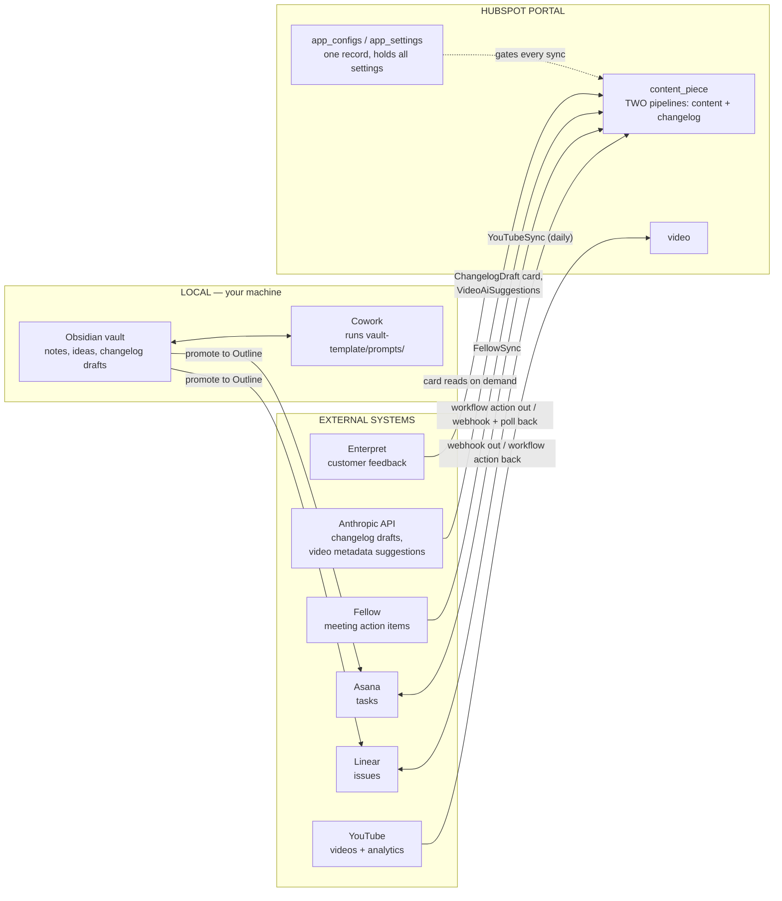
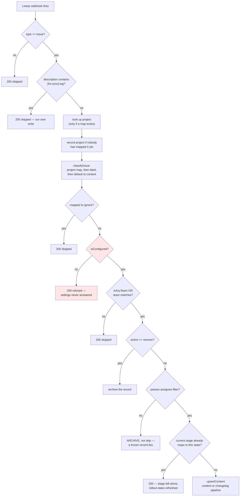
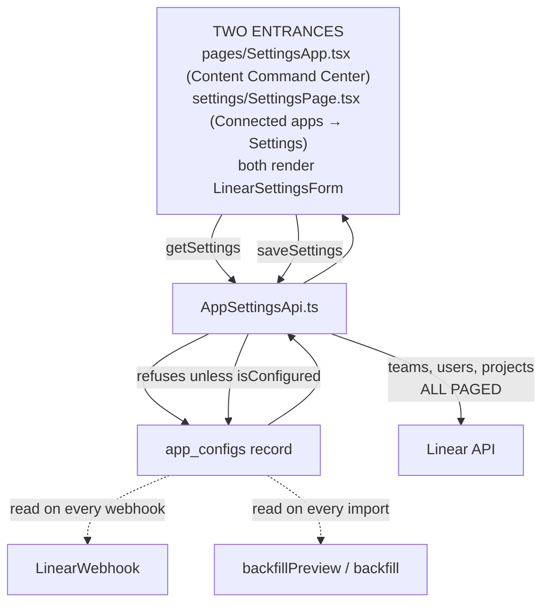
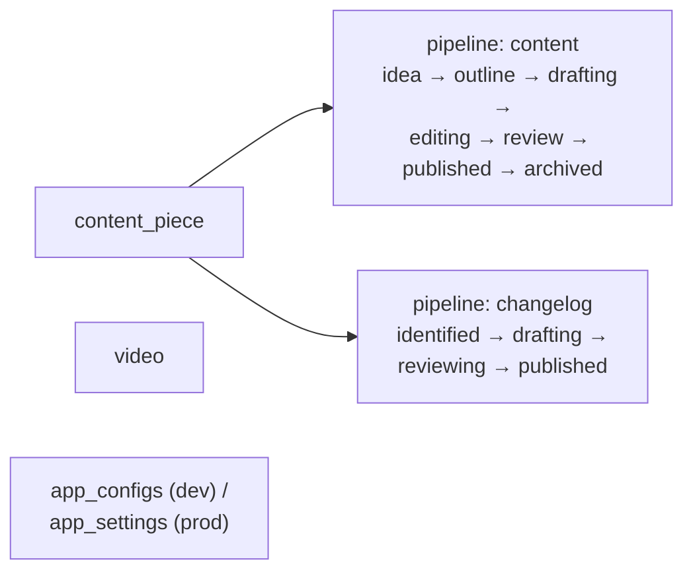
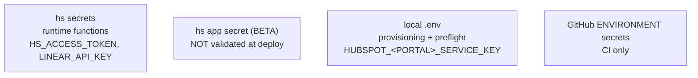

# Architecture

How the Central Brain fits together. Read this before changing sync behaviour —
most of the bugs in this repo's history came from not knowing which component
owned a decision.

GitHub renders the diagrams below. Both machines see this file because it is
checked in; nothing here lives in a chat window or a local note.

---

## 1. The whole system

**The rule that matters:** a note becomes an Outline before anything leaves
your machine. Ideas stay local. Promotion to Outline is the single threshold
that creates both the Linear issue and the Asana task.

---

## 2. Linear → HubSpot (the path that writes records)

This is the flow that once created 34 unwanted records on production. Every
guard below exists because something got through.

**`isConfigured` is checked before the team filter, and that order is load-bearing.**
The team filter fails open — an empty team id skips it — so an unconfigured
portal accepted every team until the gate above it existed.

**Excluded issues are archived, not skipped.** Skipping leaves the HubSpot
record frozen at its last synced stage: still in the pipeline, looking live, no
longer tracking anything, returning 200 the whole time.

**The stage-match skip is no longer a bare return.** It protects the *stage*,
which is all it was ever for, but a description edit can move a rollout
milestone while the issue sits in one state throughout. Since PR #108 that
branch calls `refreshDerivedProperties` and answers
`{"skipped":true,"reason":"stage already matches","refreshed":true}`. Before
that, adding a date to an existing issue produced no write and the pipeline
board kept sorting on the old one.

### Rollout milestone dates

`notes` carries the Linear issue description, which for rollout issues is a
structured template with a `### Timeline` block. `rolloutProperties` in
`src/app/lib/changelog-source.ts` parses it into `rollout_private_beta_date`,
`rollout_public_beta_date`, `rollout_live_date`, and the sort key
`rollout_priority_date` / `rollout_priority_stage` — the next milestone that
forces action. Two rules are load-bearing:

- **`1970-01-01` is not a date.** An unset HubSpot date comes back as epoch
  zero. Measured on production: 23 of 70 changelog records carry a `### Timeline`
  block, and 10 of those 23 hold `1970-01-01`. Sorting
  ascending without excluding it puts the unset records first.
- **No milestone at all means write nothing.** `rolloutProperties` returns
  `null` rather than a set of empty strings, so a date typed into HubSpot by
  hand survives a sync. Once the notes *do* carry a milestone, Linear is
  authoritative and every key is written, `''` included — that is what clears a
  milestone removed upstream. PRs #105, #108, #109.

`rollout_priority_upcoming` is deliberately **not** stored: it is relative to
today, so a stored copy is right for one day. `ContentDataApi` computes it at
read time, and `SettingsApp.tsx` orders each pipeline column by it.

### Rollup releases and their digest doc

Each changelog digest is a **Linear release** in the "Monthly Changelog
Rollups" pipeline — the monthly rollups (`October 2026 Changelog Rollup`) and
the Spotlights (`Spring 2027 Spotlight`) alike. Membership is the pipeline's id
(`ROLLUP_PIPELINE_ID`), not the release name; until 2026-10-26 it was the name
pattern, and Spotlight issues showed no release.
The digest's owner — usually not me — attaches its Google Doc to the release as
a link. Two properties on the entry follow it: `changelog_rollup` (the release
name) and `changelog_doc_url` (the doc). Spec:
`docs/superpowers/specs/2026-10-20-rollup-doc-link-design.md`.

**Who decides.** The rule lives once, in `src/app/lib/rollup-doc.ts`, and two
paths apply it:

| path | when | does |
|---|---|---|
| `LinearWebhook` → `applyRollup` | every issue update, after the stage write, in **both** branches | **sets** `changelog_rollup` from the payload and `changelog_doc_url` from the release's links. Never clears |
| `RollupDocSync` | daily workflow on App Config | **sets and clears**, from every rollup release's links and full issue list |

**`changelog_doc_url` has three writers now**: Create Doc on the changelog card,
a person, and these two paths. A rollup release's doc **wins** over whatever is
there. Only a *rollup doc* — the doc of any rollup release, compared by Google
Doc id — is ever **cleared**, which is how a link the rollup paths wrote is told
apart from one a person or Create Doc wrote, with no provenance stored.

**Neither path creates a record.** The webhook writes with `updateByLinearId`,
which answers `false` on 404 where `hsUpsertByUniqueProperty` would create. The
sweep only considers entries a search finds. So issues in a rollup that belong
to other people never become records here.

**The webhook's step cannot fail the webhook.** It runs after the stage has
synced; a Linear error still writes the release name, and a write error is
reported in the response body as `rollup`, with a 200.

**The sweep's reads are strict.** It decides "this issue left its rollup" from
the issue's *absence* from Linear's list, so a partial list would clear real
links. `fetchEveryPage` and `searchAll` throw rather than return part of a set —
unlike `AppSettingsApi`'s `fetchAllPages`, which is lenient on purpose — and
every read happens before any write.

**An issue in two rollup releases gets neither.** A Spotlight counts, so an
issue in October and in Spring Spotlight is skipped and reported by both paths.
That was the accepted cost of counting the whole pipeline.
---

## 3. Settings — one record gates everything

Stored on the single `app_configs` record:

| property | notes |
|---|---|
| `linear_team_id` | **primary display property** — HubSpot will not let it be cleared, so "any team" is the sentinel string `'any'`, never `''`. Always read it through `isAnyTeam()`. |
| `assignee_filter` | `all` \| `assigned` \| `mine` |
| `linear_assignee_id` | required when the filter is `mine` |
| `linear_project_map` | `{ projectId: 'content' \| 'changelog' \| 'ignore' }` |
| `linear_unmapped_projects` | projects seen in the wild that nobody has routed yet; drives the banner |
| `changelog_prompt_standalone`, `changelog_prompt_rollup` | per-portal overrides for the drafting prompts. Empty means "use the shipped default", so a portal that has not deliberately customised its wording keeps receiving improvements |
| `changelog_model`, `changelog_thinking` | which model drafts, and whether it thinks first. Empty means the defaults in `changelog-model.ts` — Sonnet, thinking off |

### The settings surface, and why the form exists twice

This section said until 2026-10-01 that `SettingsApp.tsx` was the only settings
page and that a `type: "settings"` component "renders nowhere for this private
app." **That was a correct reading of the portal on 2026-09-29 and is now
wrong.** The app's entry under Connected apps showed Overview and Insights with
no Settings tab; it now shows **Overview / Settings / App cards**, and a probe
carrying nothing but a success alert (PR #100) rendered there. The platform
changed, not the configuration — the hsmeta was byte-for-byte the documented
shape the whole time. Issue #88 asked the question; PRs #100–#102 answered it.

So there are two entrances, and exactly one implementation:

| File | Role |
|---|---|
| `src/app/pages/LinearSettingsForm.tsx` | the form. **The only copy anyone edits** |
| `src/app/pages/SettingsApp.tsx` | Content Command Center page — renders the form with a Back link |
| `src/app/settings/SettingsPage.tsx` | the Settings tab — renders the form with no Back link, because a destination is not a detour |
| `src/app/settings/LinearSettingsForm.tsx` | **generated.** `npm run sync:settings-form` writes it, `npm run build` runs that first, and `settings-form-in-sync.test.ts` fails while the two differ |

The copy is not a lapse. HubSpot bundles each extension directory in isolation:
the upload moves one directory to its own temp root and resolves from there, so
`../pages/LinearSettingsForm.tsx` cannot resolve and neither could a shared
`../lib` module. Sharing by import is unavailable, so the file has to exist in
both places. What made the 2026-09-29 duplication harmful was that *both copies
were editable* and nothing noticed when they diverged — three changes landed in
the invisible one. A copy that cannot silently drift is a different thing.

`PageTitle` comes from `@hubspot/ui-extensions/pages`, a pages-only subpath, so
the shared form must not import it. Each entrance renders its own chrome.

---

## 4. The data model

**A changelog is content.** It lives on `content_piece` in a second pipeline,
not in its own object — separate objects meant duplicate properties, duplicate
associations and routing complexity for no benefit. The workflow actions
distinguish the two with an `objectType: 'content' | 'changelog'` input field,
never by which HubSpot object they were called from.

`changelog_entry` was the leftover from before that consolidation. **It is gone
from both portals** — checked 2026-10-20 against each portal's schema list: dev
has `content_piece`, `video` and `app_configs`; prod has `content_piece`,
`video`, `app_settings` and an unrelated `emp_advocacy_stories`.
`provision-asana-property.ts` already treats its absence as the expected state.

---

## 5. What runs on a schedule, and what does not

**Everything scheduled is a HubSpot "(Daily)" workflow.** No GitHub Action runs
on a cron any more. The cadence is the workflow's top-level `enrollmentSchedule`
(`{"type":"DAILY","timeOfDay":{"hour":17,"minute":0}}`), separate from its
`enrollmentCriteria` — whose `type: 'MANUAL'` describes which records enrol, not
how often. Reading one for the other is why the YouTube sync spent three weeks on
a GitHub cron. `provision-workflows.ts` creates each daily **disabled and
unscheduled**; schedule it and turn it on in the UI.

| Thing | Trigger | Reality, checked 2026-10-26 |
|---|---|---|
| `AsanaPoll` | *Asana → Poll for Stage Changes (Daily)* | on, 17:00, both portals (prod since 2026-10-26) |
| `FellowSync` | *Fellow → Sync Action Items to Tasks (Daily)* | on, 17:00, both portals — and failing: every Fellow path answers 404 (`PROJECT-CONTEXT.md` §3.1) |
| `YouTubeSyncAction` | *YouTube → Sync Metrics (Daily)* | on, 17:00, both portals since 2026-10-26. Was a GitHub cron until 2026-10-20. **Prod's fails** until its YouTube refresh token is re-authorised |
| `RollupDocSync` | *Changelog Rollup Docs (Daily)* | on, 17:00, both portals since 2026-10-26. Catches what no webhook announces — a doc attached to a release after its issues, a completed release rolling issues on |
| `app-health` | `PORTAL=… npm run health`, **on demand** | its daily cron was removed in #125: the prod job inherited the deploy approval gate and fourteen runs queued unreported |
| `LinearWebhook` | Linear push | real-time |
| Deploys | merge to `develop` → Dev; `master` → Prod, triggered by hand | see the deploy traps in `CLAUDE.md` |

**Prod's Central Brain workflows were all off until 2026-10-26**, so no HubSpot →
Linear/Asana sync and no daily job ran there before that. The Changelog sync was
paused again within the hour, for the bounce bug #142 fixes. The two sync workflows
went on with their `'any'` team — `SyncToLinear` asks each existing issue for its
own team.

**`app-health` is the only check that would notice a dead credential.**
`npm run preflight` is entirely structural — object ids, pipelines, stages,
properties — and a revoked key passes every one of its checks. Three
credentials have died silently here: the HubSpot service key (a day to
diagnose), the YouTube refresh token, and `ANTHROPIC_API_KEY`, which was
invalid in `.env` and on both portals at once. The probes run *inside the app*,
because the credentials live in four separate homes (§6) and validating a copy
in CI proves nothing about the one the running functions use. It runs only when
someone runs `npm run health`, so run it before trusting a quiet portal.

---

## 6. Credentials — four separate homes

Getting these confused has cost more time than any bug in the app.

A GitHub **environment** secret is invisible to a job that does not declare
`environment:` — `secrets.X` then resolves to an empty string rather than
failing. Rotating a key in one home does not rotate it in the others;
`npm run preflight` prints a key fingerprint so you can tell which one a portal
is actually using.
